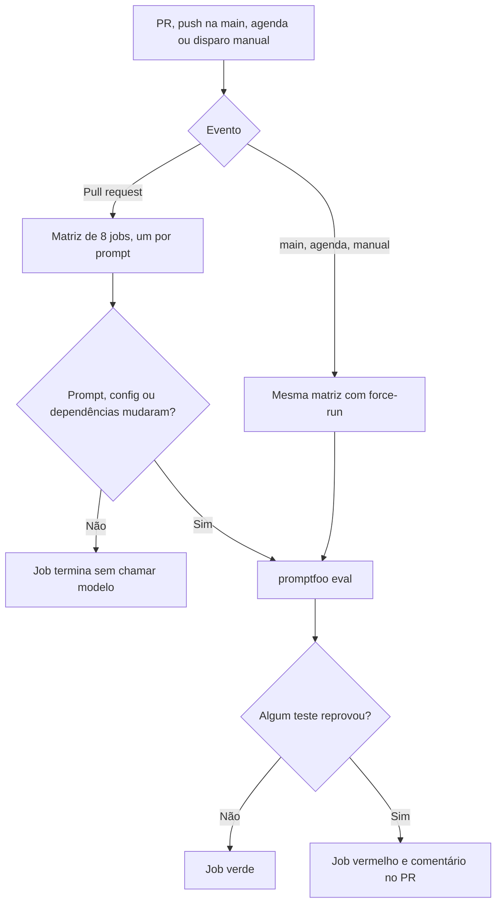

# Gate de qualidade dos prompts (CP10)

Este documento descreve o pipeline que roda a suíte de testes do playbook a cada alteração e justifica as decisões de design do gate. O workflow está em [`.github/workflows/promptfoo.yml`](../.github/workflows/promptfoo.yml).

## Estratégia de gate

Regressão, neste playbook, é uma alteração que faz um prompt deixar de passar na sua suíte. A linha de base é o estado atual: os 8 prompts passam em todos os testes (commits `22dd1b6`, `8b48cce` e `f630a13`).

| Evento | O que roda | O que reprova o build |
|---|---|---|
| Pull request | só os prompts cujos arquivos mudaram (prompt, config, `dados/`, `juiz/`) | qualquer teste reprovado no job do prompt alterado |
| Push na `main` | suíte completa | qualquer teste reprovado em qualquer prompt |
| Segunda-feira, 06:00 UTC | suíte completa | idem |
| Disparo manual | suíte completa | idem |

O que cada suíte verifica:

- **Sete prompts, só asserts determinísticos:** estrutura (títulos e seções na ordem), preservação de números e nomes, rótulos, limites de palavras, frase fixa de entrada insuficiente, limites de latência e custo. Todos bloqueiam.
- **Causa-raiz, asserts mais juiz LLM:** o juiz (Sonnet 5.5) aplica a rubrica de quatro critérios e reprova a saída com total abaixo de 6 ou com algum critério zerado. O job roda a suíte 3 vezes e cada teste precisa passar em pelo menos 2 (`repeat-min-pass`).

## Decisões de design

Cada decisão compara pelo menos duas alternativas. Os números de custo e latência vêm das execuções reais dos CP08 a CP10.

### 1. O que faz o build falhar

| Alternativa | O que se ganha | O que se perde |
|---|---|---|
| (a) Só asserts determinísticos | build estável e barato, sem juiz | não detecta queda de qualidade que respeita o formato (por exemplo, a causa-raiz trocada por um sintoma) |
| (b) Asserts mais nota mínima do juiz | pega regressão de qualidade, e a calibração do CP09 mostrou concordância com a avaliação humana | um juiz não determinístico pode reprovar o build por flutuação; custo de chamadas extras |
| (c) Asserts bloqueiam, juiz só comenta | nunca reprova por flutuação do juiz | a regressão de qualidade passa sem barrar nada, o que esvazia o gate para o prompt que mais depende de julgamento |

**Escolha: (b), restrita à causa-raiz.** É o único prompt com rubrica calibrada, e é onde o determinismo não alcança. Os sete restantes usam (a), porque suas propriedades relevantes são verificáveis por regra.

### 2. Flutuação do juiz

| Alternativa | O que se ganha | O que se perde |
|---|---|---|
| (a) Uma execução, corte em 6 | custo mínimo | uma saída real fica perto do corte (na calibração, o juiz deu total 6 e 7 às duas amostras reais), então um desvio de 1 ponto reprova o build sem regressão |
| (b) `repeat 3` com `repeat-min-pass 2` | tolera um desvio isolado do juiz ou do prompt e continua barrando uma queda consistente | triplica o custo do job (a causa-raiz custa cerca de US$ 0,08 por execução sem o juiz) |
| (c) Baixar o corte para 5 | menos reprovações por ruído | o corte deixa de ser o da rubrica do CP09, e uma saída com um critério fraco passa |

**Escolha: (b).** Na calibração, as duas rodadas do juiz deram notas idênticas nas 5 amostras, mas duas rodadas não provam estabilidade, e o próprio prompt também varia entre execuções.

### 3. Escopo da execução: suíte inteira ou só os alterados

| Alternativa | O que se ganha | O que se perde |
|---|---|---|
| (a) Suíte inteira em todo PR | nenhuma regressão escapa por não ter sido testada | cerca de US$ 0,85 mais o juiz por execução de PR, para validar prompts que não mudaram |
| (b) Só os prompts alterados | um PR típico custa de US$ 0,04 a 0,20 e termina em poucos minutos | não vê regressão em prompt que não foi tocado: mudança de comportamento do modelo no provedor ou alteração em arquivo compartilhado |
| (c) Alterados no PR, suíte completa na `main`, na agenda semanal e sob demanda | custo baixo por PR e cobertura total fora dele | a regressão de um prompt não alterado só aparece depois do merge ou na execução semanal |

**Escolha: (c).** A agenda é **semanal** e não diária: a suíte completa custa cerca de US$ 1 por execução, o que daria cerca de US$ 30 por mês numa agenda diária contra cerca de US$ 4 numa semanal. Cada push na `main` que toca arquivos de prompt também roda a suíte completa.

Custo medido por prompt (soma dos casos das últimas execuções; nota, triagem e networkpolicy vêm do CP08):

| Prompt | Custo por execução (US$) |
|---|---|
| nota-de-triagem | 0,04 |
| triagem-de-pods | 0,05 |
| networkpolicy-sentinel | 0,10 |
| diagnostico-do-forge | 0,07 |
| passos-da-migracao-do-forge | 0,19 |
| plano-de-migracao-do-forge | 0,20 |
| backpressure-no-relay | 0,14 |
| causa-raiz (sem o juiz) | 0,08 |
| **Total** | **cerca de 0,85, mais as chamadas do juiz** |

### 4. Como controlar o custo de chamar modelo a cada PR

| Alternativa | O que se ganha | O que se perde |
|---|---|---|
| (a) Cache do promptfoo entre execuções | reexecução do mesmo commit sai de graça | esconde variação do modelo: um teste pode passar por resposta antiga, e a medição de latência e custo deixa de ser real |
| (b) Um provedor só nos PRs | corta cerca de metade do custo | cobre menos: nas execuções do CP10, **todas** as falhas reais foram do Sonnet 5.5 (limite de palavras no `passos`, rótulos no `diagnostico`), então um PR só com o GPT as teria deixado passar |
| (c) Filtro de caminhos, cancelamento de execução anterior, `max-concurrency` baixo e bloqueio de fork | só paga quando algo relevante muda, e um push novo no PR cancela a execução que ficou obsoleta | não reduz o custo de uma execução que de fato roda |

**Escolha: (c), sem cache e com os dois provedores.** O filtro de caminhos exclui o `README.md`, para que uma alteração de documentação não chame modelo.

### 5. Onde ficam as chaves dos provedores

| Alternativa | O que se ganha | O que se perde |
|---|---|---|
| (a) Secrets do repositório (`OPENAI_API_KEY`, `ANTHROPIC_API_KEY`) | configuração simples; a action mascara as chaves no log | qualquer workflow do repositório pode lê-las |
| (b) Secrets de um `environment` com aprovação manual | exige aprovação humana antes de cada execução que usa a chave | trava cada PR até alguém aprovar, o que atrapalha um fluxo de uma pessoa só |
| (c) Cofre externo com credencial de curta duração | chaves sem vida longa no GitHub | exige infraestrutura adicional, o que é desproporcional para um repositório de uma pessoa |

**Escolha: (a).** O repositório é privado, o workflow usa o evento `pull_request` e não `pull_request_target`, e um PR de fork não recebe secrets (o job é ignorado nesse caso). As chaves nunca ficam no repositório nem passam por quem escreveu o workflow.

### 6. Referência do gate: limiar absoluto ou comparação com a versão anterior

| Alternativa | O que se ganha | O que se perde |
|---|---|---|
| (a) Limiares absolutos (asserts passam e juiz ≥ 6) | critério simples, estável e igual para todo PR | não pega uma queda dentro da faixa aprovada (juiz de 8 para 6) |
| (b) Comparação com o resultado da versão anterior | detecta piora relativa | exige guardar e comparar resultados, e a flutuação do juiz geraria falsos alarmes |

**Escolha: (a).** Como a linha de base está toda verde, o limiar absoluto reprova exatamente quando uma mudança faz um prompt deixar de passar. A queda dentro da faixa aprovada fica como risco aceito.

### 7. Versões fixas

| Alternativa | O que se ganha | O que se perde |
|---|---|---|
| (a) `latest` e tags móveis | recebe correções sem trabalho | uma versão nova do promptfoo ou da action pode mudar resultados sem que o prompt mude |
| (b) promptfoo 0.125.1 e actions fixadas pelo SHA do commit | o pipeline mede o prompt, e não a ferramenta; é a mesma versão dos testes locais | atualizações passam a ser manuais |

**Escolha: (b).**

## Riscos conhecidos e o que a primeira execução precisa confirmar

- **Não executado localmente.** Validei o YAML do workflow, a matriz e a resolução dos caminhos das configs a partir da raiz do repositório (com chaves falsas). O comportamento da action só se confirma numa execução real no GitHub.
- **Confirmado na primeira execução:** o job fica vermelho quando um teste reprova (`Promptfoo evaluation failed (exit code 100)`).
- **Ainda a confirmar:** o job de um prompt não alterado precisa terminar sem chamar modelo num pull request.
- **Comentários no PR:** cada job do prompt que roda comenta o resultado. Num PR que altera vários prompts haverá vários comentários.
- **Tolerâncias herdadas:** os testes aceitam 20% acima do limite de palavras do prompt e 95% de itens com rótulo (ver a Curadoria dos READMEs de `diagnostico-do-forge` e `passos-da-migracao-do-forge`). O gate herda essa tolerância.
- **Agenda:** o GitHub desativa workflows agendados em repositórios sem atividade por 60 dias.

## Observação da primeira execução completa

A primeira execução da suíte completa (push na `main`, execução `43340623711`) **não passou de primeira**:

| Tentativa | O que rodou | Resultado |
|---|---|---|
| 1 | os 8 jobs | 6 verdes e 2 vermelhos: `nota-de-triagem` (4 de 6 testes; a entrada do Sentinel reprovou nos dois modelos) e `passos-da-migracao-do-forge` (2 de 4; o caso principal reprovou nos dois modelos) |
| 2 | só o `nota-de-triagem` | passou |
| 3 | só o `passos-da-migracao-do-forge` | passou |

Nenhum arquivo mudou entre as tentativas, então as duas falhas foram intermitentes. **A causa não foi determinada:** o log da action mostra a tabela de saídas, mas não o motivo de cada assert reprovado, e a action apaga o JSON de resultado. Hipótese não confirmada para o `nota`: ele tem os limites mais apertados da biblioteca (5 s e US$ 0,01, com o Sonnet em 0,0089 a 0,0098 nas medições locais).

Consequências para o gate:

- Num total de 8 jobs, 2 reprovaram por variação na primeira execução. Com a regra "qualquer teste reprovado derruba o job", a suíte completa pode ficar vermelha sem que nenhum prompt tenha piorado, e a reexecução manual é o que resolve hoje.
- Para tornar a próxima falha diagnosticável, o workflow passou a exportar o resultado da avaliação (`promptfoo export eval latest`) e a guardá-lo como artefato `resultado-<prompt>`, mesmo quando o job falha. O arquivo traz o motivo de cada assert e as saídas dos modelos.
- Se a intermitência se repetir, as saídas possíveis são ampliar a margem dos limites mais apertados ou estender `repeat` e `repeat-min-pass` aos demais prompts, ao custo de repetir as chamadas. A decisão fica para depois de ver o motivo real nos artefatos.

### Segunda execução completa

A execução `43342657991` (commit `a19c50a`, a primeira com o artefato de resultado) teve 7 jobs verdes e o `backpressure-no-relay` vermelho. O `nota-de-triagem` e o `passos-da-migracao-do-forge`, que tinham falhado na primeira suíte, passaram.

O artefato `resultado-backpressure-no-relay` mostrou o motivo: o GPT 6 Sol reprovou só no assert de ambiguidade do "throughput sustentado". O modelo registrou a ambiguidade ("Não se sabe se 180.000 mensagens/s representa carga corrente ou capacidade de entrega"), mas com uma redação que o regex do assert não previa. **Foi um defeito do teste e não uma regressão do prompt**, e a terceira redação diferente que o assert encontrou em três execuções. A correção troca a busca por frases por uma checagem de conteúdo: alguma linha precisa citar o valor de 180.000 (ou "sustentado") e mencionar "capacidade" e "carga". Foi validada contra quatro saídas reais, inclusive a que reprovou, e uma saída que cita o 180.000 só como fato continua reprovando.

Nas duas suítes completas, 3 dos 16 jobs ficaram vermelhos. Um tem causa conhecida (defeito do teste). Os outros dois (`nota` e `passos`, na primeira suíte) ficaram sem causa, porque o artefato com os motivos ainda não existia.

## Evidência de execução

A preencher depois das execuções no GitHub:

| Evidência | Link da execução | Resultado |
|---|---|---|
| Sucesso: suíte completa por disparo manual | a registrar | a registrar |
| Falha provocada: PR com prompt regredido | a registrar | a registrar |
